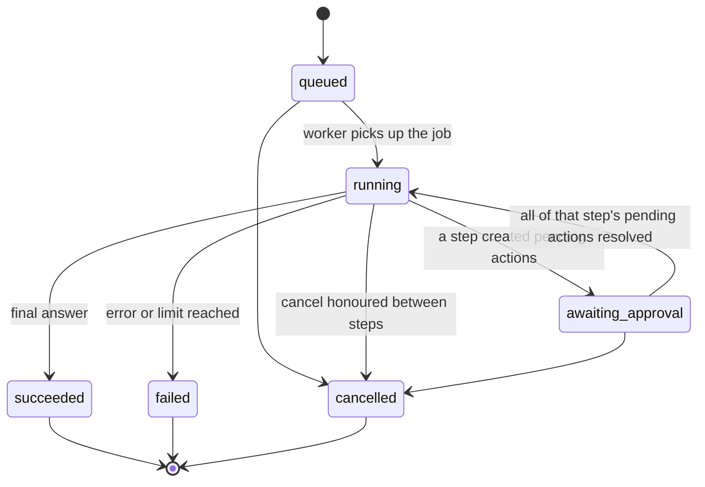
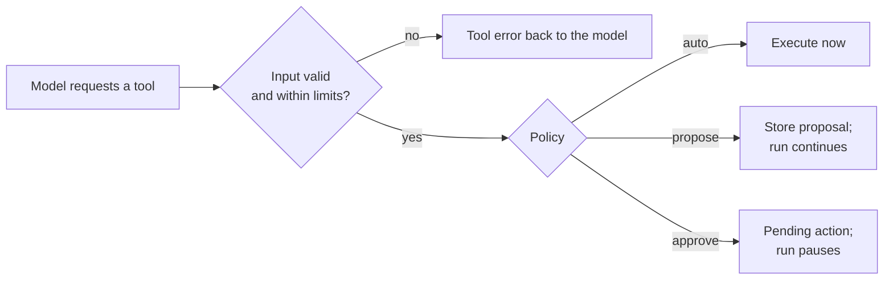
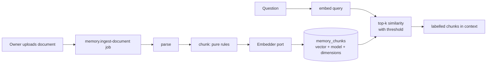
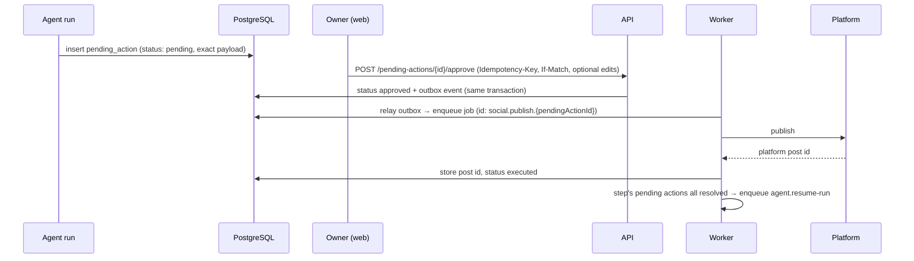
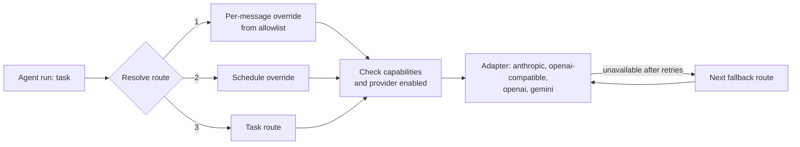

# Agent design

**How an agent run works: its lifecycle, the tool-calling loop, context building, tools, memory, approvals, model routing and limits. Rules here implement conventions §15.**

## 1. Run lifecycle

Every trigger creates one `agent_run` (BR-20). The loop never knows what triggered it. Every run executes in the worker and can pause for approval and resume ([ADR-0010](../decisions/ADR-0010-resumable-runs-in-worker.md)).



- **Pause:** once every tool call in a step is handled and the step created at least one pending action, the run moves to `awaiting_approval` and its job ends. No worker waits.
- **Resume:** when each of that step's pending actions is executed, failed, rejected or expired, the outcomes become the tool results and an `agent.resume-run` job continues the loop. The model sees what happened ("published, post id …", "rejected by the owner").
- **Budgets:** the wall-clock limit counts running time only; waiting is bounded by pending action expiry (BR-05).
- **Interruption:** a stalled job is retried and resumes from the last persisted step.

| Trigger | Where the run executes | Output |
| --- | --- | --- |
| Chat message | Worker; the API relays its events over SSE | Assistant message; maybe pending actions, then a resumed answer |
| Schedule | Worker | Pending action for a post; owner notified |
| Webhook (comment) | Worker | Pending action for a reply |

## 2. The loop

```mermaid
sequenceDiagram
  participant S as AgentRunService
  participant C as ContextBuilder
  participant L as LlmProvider
  participant T as ToolRegistry
  participant A as ApprovalService
  S->>C: build context (system prompt, profile, memory, history)
  loop until final answer or limit
    S->>L: messages + tool definitions
    L-->>S: text and/or tool requests + usage
    S->>S: persist step, record llm_call, check budgets
    S->>T: execute requested tools (validated with Zod)
    alt policy approve
      T->>A: create pending action
      A-->>T: pending action id
    end
    T-->>S: tool results (or tool errors)
    opt step created pending actions
      S->>S: status awaiting_approval, job ends
      Note over S,A: owner decides; execution job runs
      A->>S: all resolved → agent.resume-run
      S->>S: outcomes become tool results, status running
    end
  end
  S-->>S: persist final answer, mark run finished
```

Events (`text.delta`, `tool.called`, `approval.required`, …) go to the run's Redis Stream as they happen; the API relays them over SSE (ADR-0010).

- **Limits** (BR-21): `MAX_AGENT_ITERATIONS`, per-run token and cost budgets, a wall-clock timeout. Each limit ends the run with its problem code (`RUN_ITERATION_LIMIT`, `RUN_BUDGET_EXCEEDED`).
- **Parallelism:** independent `read` tools may run in parallel; `local_write` and `external` tools run one at a time.
- **Errors:** invalid tool input or a failing tool returns an error result to the model so it can correct itself. Provider rate limits and overloads retry with backoff; other provider errors fail the run.
- **Cancellation** is checked between steps.

## 3. Context building

Order matters for prompt caching: the stable prefix comes first and is cached.

| Part | Source | Cached |
| --- | --- | --- |
| System prompt (role, rules, untrusted-content rule, output format) | Versioned prompt file for the task | Yes |
| Tool definitions | Tool registry, filtered by task | Yes |
| Owner profile | Profile service | Yes |
| Retrieved memory, labelled with sources | Retrieval service | No |
| Conversation history (recent turns verbatim, older summarised) | Pure history rule | No |
| Current input; untrusted content wrapped and labelled | Trigger | No |

## 4. Tools

Every tool has an effect tier and a policy ([ADR-0011](../decisions/ADR-0011-tool-effect-tiers-and-policy.md)). The tier is a floor: `external` tools always need approval.

| Tool | Module | Effect | Policy | Phase |
| --- | --- | --- | --- | --- |
| `get_current_time` | tools/builtin | `read` | `auto` | 1 |
| `search_memory` | memory | `read` | `auto` | 2 |
| `get_post_history` | social | `read` | `auto` | 2 |
| `publish_post` (`platforms`, `text`, optional `media`) | social | `external` | `approve` | 3 |
| `list_new_comments` (`platform`, `postId`) | social | `read` | `auto` | 5 |
| `reply_to_comment` (bound to one comment per run, BR-64) | social | `external` | `approve` | 5 |



Tools per task (least privilege):

| Task | Tools available |
| --- | --- |
| `chat` | `get_current_time`, `search_memory`, `get_post_history`, `publish_post` |
| `draft_post` | `search_memory`, `get_post_history`, `publish_post` |
| `draft_reply` | `search_memory`, `reply_to_comment` (bound) |

The `platform` parameter's allowed values are generated from the adapter registry, so adding a platform adds no tools (conventions §15.4, §16).

### Tool sources

The tool registry collects tools from **tool sources** behind a `ToolSource` port (`packages/core/src/tools/tool-source.port.ts`: `key`, `listTools()`, `callTool(name, input, context)`).

| Source | Where | Phase |
| --- | --- | --- |
| Built-in tools | `packages/core/src/<module>/*.tools.ts` | 1 |
| MCP servers (Khadim as an MCP client) | `packages/integrations/src/mcp`, one configured server per source | 6, with its own plan and ADR |

Rules for MCP tools, so a new source cannot widen the agent's power by itself:

- Only servers the owner lists in configuration are connected; their credentials stay in env and never reach model context.
- Every MCP tool starts disabled. The owner enables it by giving it an effect tier and a policy (ADR-0011); until then it counts as `external`.
- Tool descriptions and results from MCP servers are untrusted content (tool poisoning, prompt injection). The description approved with the tool is pinned; if the server changes it, the tool is disabled until the owner re-approves.
- Input is validated against the tool's schema before the call; results are wrapped and labelled as untrusted, and size-limited.
- Names are namespaced to avoid collisions. > **Default:** `mcp_<server>_<tool>` in snake_case.
- Running local (stdio) servers needs a sandboxing decision, recorded in the Phase 6 ADR.

## 5. Memory



- Profile: structured and validated; always in the cached prefix.
- Retrieved chunks carry their document title so answers can cite it (BR-31).
- One embedding model is active at a time; changing it triggers a re-index job, and vectors from different models are never mixed (BR-33).

## 6. Approvals



Rules: BR-02 to BR-06. Executing twice is impossible: deterministic job id, stored platform post id, and a status check before calling the platform. Rejection and expiry also resolve a pending action and can resume the run.

## 7. Providers and model routing (ADR-0009)

The loop talks only to the `LlmProvider` port. Which provider and model answer a call is decided by configuration.



| Task | Default model class | Why |
| --- | --- | --- |
| `chat`, `classify`, `summarise` | Small, fast model (could be local) | Cost and latency for frequent calls |
| `draft_post`, `draft_reply` | Stronger model | Writing quality matters; few calls per day |
| `eval_grader` | Stronger model | Reliable judgements |

> **Default:** Every task routes to Anthropic until other adapters exist. Exact model ids, prices and limits live in the model catalog configuration read by `model-registry.ts`, never in services.

- Capabilities gate routing: a task that needs tools never routes to a model without tool support (BR-25).
- Fallbacks run only after retries are exhausted on provider outage or rate limiting, and are recorded on the run (BR-26).
- History is stored provider-neutral, so a conversation can switch model between messages.
- Only enabled providers receive owner data (BR-27).

## 8. Prompts

- Files: `packages/core/src/agent/prompts/<purpose>.v<n>.md`. A change creates a new version.
- Each run stores `prompt_version`. Prompt changes must pass evals against the previous baseline (conventions §15.10).
- A provider-specific variant (`post-writer.v2.gemini.md`) is used only when evals show the base prompt underperforms on that provider.

## 9. Security

The controls for prompt injection, excessive agency, output handling and unbounded consumption are in [security](../security.md#llm-security).
