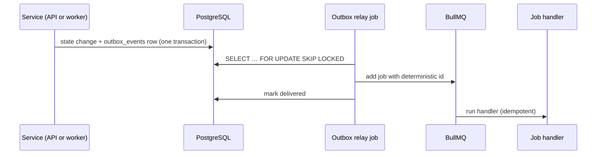

# Background jobs and schedules

**All slow or external work runs in `apps/worker` on BullMQ: every agent run and resume, publishing, replies, memory ingestion and maintenance. Rules: conventions §17; run execution: ADR-0010.**

## Queues and jobs

| Queue | Job | Job id | Triggered by | Phase |
| --- | --- | --- | --- | --- |
| `agent` | `agent.run` | `agent.run.<agentRunId>` | Chat message (enqueued directly, outbox as backstop), schedule firing, processed webhook event | 1 |
| `agent` | `agent.resume-run` | `agent.resume.<agentRunId>.<stepIndex>` | Every pending action from a paused step resolved | 3 |
| `social` | `social.publish-post` | `social.publish.<pendingActionId>` | Approved pending action (outbox) | 3 |
| `social` | `social.reply-comment` | `social.reply.<pendingActionId>` | Approved pending action (outbox) | 5 |
| `social` | `social.process-webhook` | `social.webhook.<webhookEventId>` | Stored webhook event | 5 |
| `memory` | `memory.ingest-document` | `memory.ingest.<documentId>.<version>` | Document uploaded | 2 |
| `maintenance` | `maintenance.relay-outbox` | repeatable | Every few seconds | 1 |
| `maintenance` | `maintenance.check-connection-expiry` | repeatable | Daily | 3 |
| `maintenance` | `maintenance.expire-pending-actions` | repeatable | Every 15 minutes | 3 |
| `maintenance` | `maintenance.purge-idempotency-keys` | repeatable | Daily | 1 |

## Outbox flow

A crash between steps only causes a retry; deterministic job ids and idempotent handlers make retries safe.

## Run event streams

- The worker appends each run's events to the Redis Stream `agent:run-events:v1:<agentRunId>`; the API relays it over SSE (ADR-0010).
- Streams are transient: trimmed and expired after the run ends (> **Default:** 24 hours). The durable record is in PostgreSQL.
- BullMQ queues and run event streams share the Redis instance, which uses `noeviction`, so neither loses entries under memory pressure.

## Schedules

- Stored in the `schedules` table: cron expression, IANA time zone (default `Asia/Dhaka`), task, settings, enabled.
- The worker syncs schedules to BullMQ repeatable jobs on start and whenever a schedule changes.
- A scheduled post fires ahead of its target time (BR-51) and creates a `draft_post` run; publishing follows approval (BR-52).
- Each occurrence fires once (BR-53): the occurrence time is part of the run's trigger reference, with a unique index.

## Retry policy

| Situation | Behaviour |
| --- | --- |
| Transient error (network, 429, 5xx) | Retry with exponential backoff and jitter. > **Default:** 5 attempts |
| Invalid payload | Fail once; no retry |
| Platform says "already exists" or post id stored | Treat as success |
| Attempts exhausted | Move to the dead-letter queue; mark the work `failed`; notify the owner |

Every handler has a test that runs it twice and checks there is no duplicate effect.
