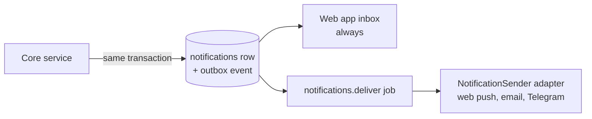

# Channels and notifications

**How the owner and Khadim talk. A channel carries a conversation in both directions; a notification is a message Khadim starts. Both are ports, so adding Telegram, email or voice needs an adapter, not changes to the agent.**

## Channels

A channel is a surface where the owner converses with Khadim.

| Channel | Key | Phase | Implemented by |
| --- | --- | --- | --- |
| Web app | `web` | 1 | `apps/web` + `apps/api` (SSE relay); the reference channel |
| Telegram, email, voice | `telegram`, `email`, `voice` | 6 | Adapters in `packages/integrations/src/channels/<vendor>` |

### Flow

```mermaid
sequenceDiagram
  participant X as Channel (webhook or poller)
  participant A as Channel adapter
  participant C as Channels service (core)
  participant DB as PostgreSQL
  participant W as Worker
  X->>A: raw inbound message
  A->>A: verify signature and sender
  A->>C: InboundMessage
  C->>DB: find or create conversation; store message; create run (one transaction)
  C->>W: agent.run
  W-->>C: run events and final answer
  C->>A: OutboundMessage (if the channel is not web)
  A->>X: send
```

- Inbound: an adapter verifies the request, checks the sender, and normalises it to an `InboundMessage` (channel, sender ref, thread ref, external message id, text, attachments, received at). The API webhook route or a worker poller calls it.
- From there the message follows exactly the same path as a web chat message: one conversation, one run in the worker (BR-20, ADR-0010).
- Outbound: the web channel reads run events over SSE. Other channels receive the final answer through `send()`, split to the channel's `maxMessageChars`; channels that support streaming may receive partial text.

### Port

`ChannelAdapter` in `packages/core/src/channels/channel.port.ts`:

| Member | Purpose |
| --- | --- |
| `key` | Channel key (`telegram`, …) |
| `capabilities` | `supportsStreaming`, `supportsInteractiveApproval`, `supportsAttachments`, `supportsMarkdown`, `maxMessageChars` |
| `parseInbound(request)` | Verify and normalise to `InboundMessage`, or reject |
| `send(message)` | Deliver an `OutboundMessage` to a thread |

### Rules

- Only the owner's linked identities can start runs from a channel; anything else is ignored and counted, never answered (BR-07).
- A redelivered inbound message never starts a second run: `messages` has its own `channel` column (held equal to its conversation's by a composite foreign key) and a unique (`channel`, `external_message_id`) (BR-20).
- Message text from the owner is owner input. Attachments are memory-like documents and therefore untrusted data (BR-34).
- > **Default:** approvals happen only in the web app. A channel can render approval actions only after an ADR shows that it authenticates the owner as strongly as the web app.
- A conversation belongs to one channel (`conversations.channel`, `conversations.channel_thread_ref`).

## Notifications

A notification is a short message Khadim sends to the owner without being asked: an approval is waiting, a run failed, the daily budget was reached (BR-22), a connection is about to expire (BR-46), a job reached the dead-letter queue.

### Flow



- Every notification is stored first; the web app inbox reads the table, so in-app delivery never depends on a third party.
- External delivery is a job per notification and sender, with a deterministic id, so retries never send twice.
- A channel adapter that can send (Telegram) may also implement `NotificationSender`.

### Port

`NotificationSender` in `packages/core/src/notifications/notification-sender.port.ts`: `key`, `send(notification)`. Adapters live in `packages/integrations/src/notifications/<vendor>`.

### Table and kinds

| Field | Meaning |
| --- | --- |
| `kind` | `approval_required`, `run_failed`, `budget_reached`, `connection_expiring`, `connection_expired`, `job_dead_lettered`, `memory_fact_proposed`, `redis_memory_high` |
| `severity` | `info`, `warning`, `critical` |
| `title`, `link` | Short text and a link into the web app |
| `subject_type`, `subject_id` | What it is about (run, pending action, connection, …) |
| `dedupe_key` | Unique per occurrence: a retried job never creates a second notification, but a reminder that a rule repeats gets one per occurrence. The key includes what makes an occurrence distinct. > **Default:** `connection_expiring:<connectionId>:<date in Asia/Dhaka>`, so BR-46's daily warnings each arrive once a day |
| `read_at` | Read marker; the only column updated after insert |

### Rules

- > **Default:** in Phase 1 delivery is in-app only. When the first external sender exists, `warning` and `critical` notifications also go there.
- > **Default:** external senders receive only the title and the link, never draft text, comment text or memory content; the owner opens the web app to see the content.
- Notifications carry no secrets and are never logged with their text (conventions §14).

> **Open question:** Should there be quiet hours (for example no external notifications at night in Asia/Dhaka), and which kinds may break them?
