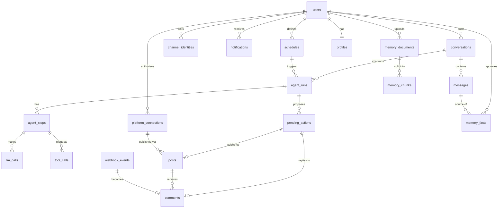

# Data model

**The planned PostgreSQL tables and their relationships. Each table is created in the phase that needs it, following conventions §13; this doc is updated with every schema change.**

> **Default:** This is the target design. Columns are indicative; the phase plan that creates a table finalises its columns, constraints and indexes.

## Conventions

- `id uuid` primary keys (`uuidv7()`), `created_at` / `updated_at` as `timestamptz` (UTC).
- Owned rows carry `owner_user_id` (single owner today; eases a future multi-user change).
- Editable rows carry `version` for optimistic concurrency.
- Append-only tables are never updated except for delivery markers.
- Cost stored as `bigint` micro-USD.

## Entity relationships

## Tables

| Table | Purpose | Kind | Phase |
| --- | --- | --- | --- |
| `users` (+ auth library tables) | The owner and sessions | Editable | 1 |
| `conversations` | Chat threads; `channel` and `channel_thread_ref` | Editable | 1 |
| `messages` | Turns in a conversation, stored provider-neutral; `external_message_id` unique per channel | Append-only | 1 |
| `channel_identities` | The owner's linked identity per channel (BR-07) | Editable | 6 |
| `agent_runs` | One row per run: trigger, task, provider, model, prompt version, status, totals, cancel-request marker, running-time counters (when it last entered `running`, running time used before pausing) | Status lifecycle | 1 |
| `agent_steps` | Loop iterations | Append-only | 1 |
| `llm_calls` | Provider, model, fallback flag, tokens (input, output, cached), cost, latency | Append-only | 1 |
| `tool_calls` | Tool name, input, output or error, duration | Append-only | 1 |
| `idempotency_keys` | Stored responses for replayed POSTs | Expiring | 1 |
| `outbox_events` | Reliable job enqueueing | Append-only + delivery marker | 1 |
| `audit_logs` | Owner actions and security events | Append-only | 1 |
| `notifications` | Kind, severity, title, link, subject, unique dedupe key ([channels](channels.md#notifications)) | Append-only + read marker | 1 |
| `profiles` | Structured owner facts (validated JSONB) | Editable | 2 |
| `memory_documents` | Uploaded documents and ingestion status | Editable, owner-deletable | 2 |
| `memory_chunks` | Text, `vector(<dimensions>)`, embedding provider, model and dimensions; HNSW index | Derived | 2 |
| `memory_facts` | Learned fact text, category, status, source conversation and message, decided at; embedding with provider, model and dimensions once active | Status lifecycle, owner-deletable | 2 |
| `platform_connections` | Platform, account id, encrypted tokens, expiry, status | Editable | 3 |
| `pending_actions` | Action type, exact payload, status, decided by and at, expiry, outcome; the run, step and tool call that created it (unique per run and tool call) | Status lifecycle | 3 |
| `posts` | Platform, text, platform post id and URL, published at | Status lifecycle | 3 |
| `schedules` | Cron expression, time zone, task, settings, enabled | Editable | 4 |
| `webhook_events` | Raw verified platform payloads | Append-only | 5 |
| `comments` | Platform comment id, author name, text, classification | Status lifecycle | 5 |

## Status values

| Table | Statuses |
| --- | --- |
| `agent_runs` | `queued`, `running`, `awaiting_approval`, `succeeded`, `failed`, `cancelled` |
| `pending_actions` | `pending`, `approved`, `rejected`, `expired`, `executing`, `executed`, `failed` |
| `posts` | `publishing`, `published`, `failed` |
| `memory_documents` | `uploaded`, `processing`, `ready`, `failed` |
| `memory_facts` | `proposed`, `active`, `rejected` |
| `platform_connections` | `active`, `expiring`, `expired`, `revoked` |

Critical transitions (`agent_runs`, `pending_actions`) are enforced in pure rules and by a database trigger. `agent_runs` may move from `awaiting_approval` back to `running` when it resumes, or to `cancelled`; never directly to `succeeded` or `failed` (ADR-0010, conventions §15.1).

## Setup notes

- The first migration runs `CREATE EXTENSION IF NOT EXISTS vector`.
- Migrations run as an owner role; the apps connect as a non-superuser role.
