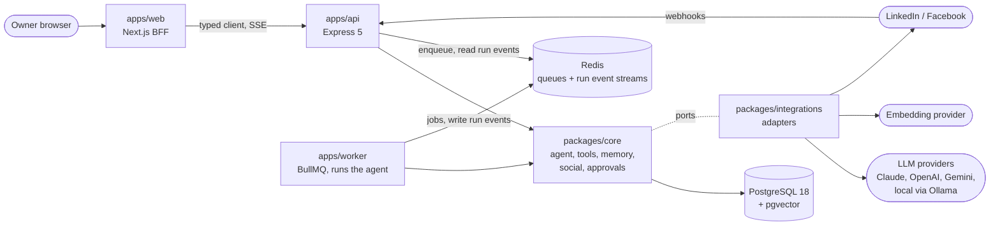

# Architecture overview

**Khadim is a TypeScript modular monolith in a pnpm monorepo: a Next.js BFF, an Express API and a BullMQ worker, all running the same agent core over PostgreSQL and Redis.**

## System diagram

## How a request flows

- **Chat:** browser → web Server Action → API `POST /api/v1/conversations/{id}/messages` → `202` with a run id; the worker runs it and writes events to a Redis Stream; the web SSE Route Handler → API `GET /api/v1/runs/{id}/events` relays them (ADR-0010).
- **Scheduled post:** worker repeatable job → core starts a `draft_post` run → a pending action is created and the run pauses → owner approves in web → outbox event → worker publishes → the run resumes with the result (ADR-0006, ADR-0010).
- **Comment:** platform webhook → API verifies and stores the raw event → worker processes it → core starts a `draft_reply` run → pending action → approval → worker replies → the run resumes and finishes.

## Principles

See [conventions §1](../development/conventions.md#1-principles). The ones that shape this architecture most:

- **Thin edges, rich core:** apps parse input and wire dependencies; all logic is in `packages/core`.
- **Ports and adapters:** core defines `LlmProvider`, `Embedder`, `SocialPlatform`, `ChannelAdapter`, `NotificationSender` and `ToolSource`; `packages/integrations` implements them, one adapter per vendor. Persistence is the written exception: repositories in core use Drizzle directly (ADR-0012).
- **Configurable models:** which provider and model serve each task is configuration, not code (ADR-0009).
- **Humans approve side effects:** every tool has an effect tier (`read`, `local_write`, `external`) and a policy; `external` tools only create pending actions (ADR-0011).
- **One run model:** chat, schedules and webhooks all create the same agent run, executed in the worker, able to pause for approval and resume.

## Technology choices

| Concern | Choice | Why |
| --- | --- | --- |
| Language | TypeScript (strict) everywhere | One language across UI, API and worker; shared types (ADR-0003) |
| Monorepo | pnpm workspaces + Turborepo | Shared packages, version catalog, cached tasks (ADR-0002) |
| Web | Next.js App Router, Tailwind CSS, shadcn/ui | BFF pattern, server rendering, accessible components |
| API | Express 5 | Mature, minimal, async error handling |
| Validation and contracts | Zod → OpenAPI 3.1 | One schema for types, validation and docs |
| Database | PostgreSQL 18, Drizzle ORM, pgvector | Relational data and vector search in one database |
| Jobs and schedules | BullMQ on Redis | Retries, repeatable jobs, deterministic job ids |
| LLM | Any provider behind the `LlmProvider` port: Anthropic first, OpenAI-compatible (local models and gateways), then OpenAI and Gemini; routed per task by configuration; hand-built loop | Learning the loop; cost control, resilience and a local option (ADR-0005, ADR-0009) |
| Embeddings | Behind the `Embedder` port; several adapters possible, one active model; first choice pending | ADR-0008 (proposed), ADR-0009 |
| Auth | Better Auth in the web app only; the BFF calls the API with a short-lived signed service token; private network access during development | Auth only at the edges; no public exposure without TOTP (ADR-0007) |
| Streaming | Server-Sent Events relayed from Redis Streams | One-way token stream over plain HTTP; replay on reconnect; runs live in the worker (ADR-0010) |
| Testing | Vitest, Supertest, Testcontainers, Playwright, evals | See [testing](../development/testing.md) |
| Observability | pino logs, OpenTelemetry traces with GenAI conventions | Replayable runs without logging content |

## Deliberately not used

| Not used | Reason |
| --- | --- |
| Agent frameworks (LangChain, LangGraph, Agent SDKs) | The goal is to learn the loop; may be revisited by ADR later |
| Microservices, Kubernetes | One owner, one deployable set; a modular monolith is enough |
| GraphQL, tRPC | REST + OpenAPI is the standard; contracts already shared via Zod |
| WebSockets | SSE covers one-way streaming |
| A hosted LLM gateway as the only abstraction | Khadim's own port keeps control and reaches local models; a gateway can still be used through the OpenAI-compatible adapter |
| A separate vector database | pgvector is enough at this scale |
| Multi-tenancy, billing | Single-user product (ADR-0001) |
| Fine-tuning | Retrieval over owner memory gives personal context more cheaply |
