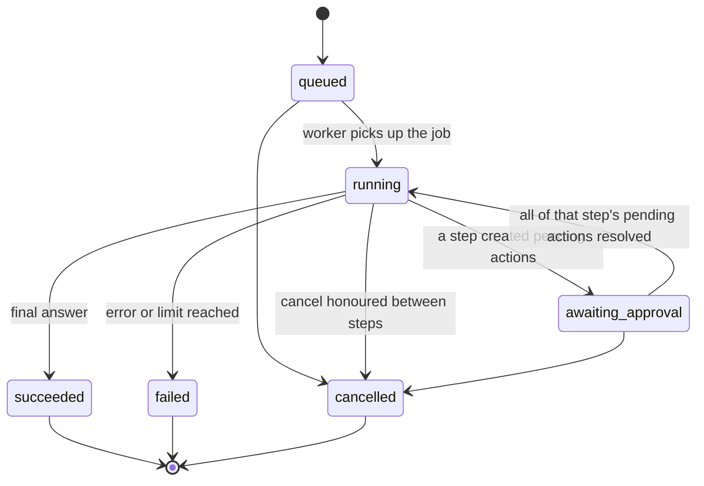

# ADR-0010: Resumable runs executed in the worker, streamed from Redis Streams

| | |
| --- | --- |
| Status | Accepted (extended by ADR-0013) |
| Date | 2026-11-10 |
| Relates to | Supersedes ADR-0004 (chat runs in the API); extends ADR-0006 (approvals) |

## Context

ADR-0004 ran interactive chat runs inside the API request and streamed them directly. Runs created by schedules and webhooks ran in the worker, so there were two execution paths. A run that created a pending action ended as `succeeded`, and the agent could not continue after the owner decided.

Khadim is meant to grow into a general assistant with long, multi-step tasks ("draft a post, publish it once I approve, then watch its comments"). Those tasks need runs that:

- survive API restarts, deploys and dropped connections;
- pause for approval without holding a process, then continue with the outcome;
- run the same way whatever triggered them.

## Decision

### 1. Every run executes in the worker

- Chat messages, schedule firings and processed webhook events each create an `agent_run` in `queued` and an `agent.run` job (job id `agent.run.<agentRunId>`). The API never runs the loop.
- Chat: `POST /api/v1/conversations/{id}/messages` (with `Idempotency-Key`) stores the message, the run and an outbox event in one transaction, answers `202` with the run id and `Location: /api/v1/runs/{id}`, then enqueues the job directly. The outbox relay is the backstop if that enqueue is lost; the deterministic job id makes a second enqueue a no-op. Enqueueing directly keeps the first token fast (NFR-1); waiting for the relay's polling interval would not.

### 2. Events flow through Redis Streams

- The worker appends typed events to a Redis Stream per run, key `agent:run-events:v1:<agentRunId>`: `run.started`, `text.delta`, `tool.called`, `tool.completed`, `approval.required`, `run.awaiting_approval`, `run.resumed`, `run.completed`, `run.failed`, `run.cancelled`.
- `GET /api/v1/runs/{id}/events` relays the stream as Server-Sent Events. The stream entry id is the SSE `id`, so a reconnect with `Last-Event-ID` continues from where it stopped. The web app proxies this through a Route Handler (BFF).
- The API sends a heartbeat comment while the run is active and closes the response after a terminal event. > **Default:** heartbeat every 15 seconds.
- Streams are transient. PostgreSQL holds the record of a run (messages, steps, LLM calls, tool calls), not every `text.delta`. After a run ends, its stream is trimmed and expires; a client that comes back later reads the run from `GET /api/v1/runs/{id}`. > **Default:** a stream expires 24 hours after its run ends.

### 3. Runs pause for approval and resume

- A write tool creates a pending action (unique per run and tool call, so a retried step cannot create a second one). Once every tool call in the step has been handled, the run moves to `awaiting_approval`, emits `run.awaiting_approval`, and its job completes. No worker is held while it waits.
- A pending action is resolved when it is executed (or its execution fails), rejected or expired (BR-05). Execution stays a separate idempotent job, as in ADR-0006.
- When every pending action from the paused step is resolved, core records each outcome as that tool call's result and enqueues `agent.resume-run` (job id `agent.resume.<agentRunId>.<stepIndex>`). The run moves back to `running` and the loop continues from persisted history, so the model sees "published, post id …", "rejected by the owner" or "expired".
- The run's wall-clock budget (BR-21) counts running time only. Waiting is bounded by pending action expiry.

### 4. Interruption and cancellation

- If a worker stops mid-run, BullMQ retries the stalled job and the loop resumes from the last persisted step. A model call whose step was not persisted is repeated; that cost is accepted.
- Cancelling (`POST /api/v1/runs/{id}/cancel`) records the request on the run. The worker honours it between steps and before resuming. > **Default:** cancelling a run in `awaiting_approval` rejects its undecided pending actions.

## Alternatives considered

- **Keep ADR-0004 (run in the API request):** simplest streaming, but runs die with the API process, there are two execution paths, and runs cannot resume after approval.
- **Worker plus Redis pub/sub:** decoupled, but pub/sub drops events while nobody is listening, so reconnects lose text. Streams can replay.
- **PostgreSQL `LISTEN/NOTIFY`:** no new component, but payload size limits and no replay.
- **Persist every event in PostgreSQL:** full replay forever, at the cost of a write per token. The durable record already lives in steps and messages.
- **WebSockets:** a two-way channel is not needed.

## Consequences

- One execution path for every trigger; runs survive API deploys; long, multi-step tasks become possible.
- The API needs Redis to relay events, and chat gains one hop (enqueue, then the worker picks up). The added latency is milliseconds, measured against NFR-1.
- Redis briefly holds run content (chat text, drafts). It stays internal, bound to localhost or a private network, and covered by the same no-logging rule as the database.
- Graceful worker shutdown finishes or abandons the current step; the retried job resumes the run.
- `agent_runs` gains a cancel-request marker, and `pending_actions` link to the run, step and tool call that created them.
